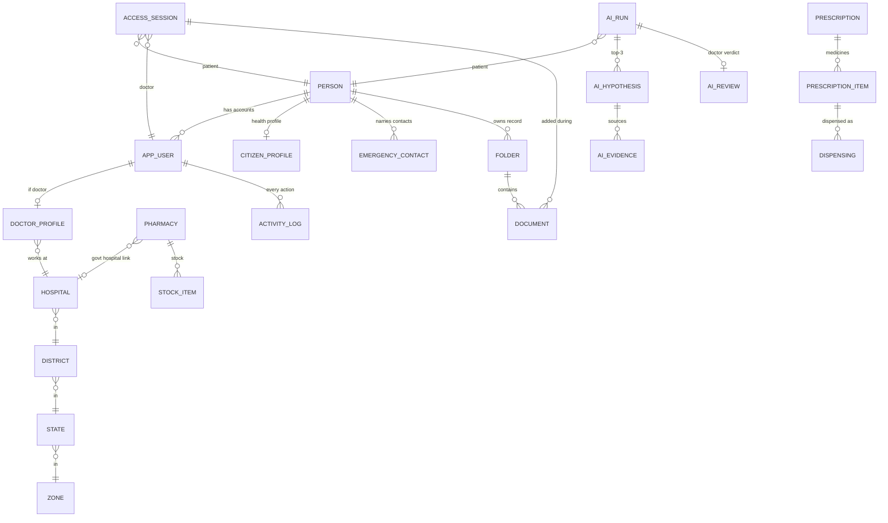

# 11 — Database Design (PostgreSQL)

> Drafted by Claude on 2026-10-11 at the user's request. **Status: APPROVED 2026-10-11** — built only from decisions in 01–10 and 04_DECISION_LOG.md. Items marked **(Claude)** are design choices the user can change.
> Database: **PostgreSQL 16** + **PostGIS**. Alpha runs on **Neon free** (synthetic data only); files on **Cloudflare R2**; cache/rotating keys in **Valkey**. Production moves to MeitY-empanelled cloud with no schema change.
> Verify all legal items (DPDP, Aadhaar, Drugs and Cosmetics rules, NOTTO) before go-live — flagged ⚠ below.
> **Updated 2026-10-11 (user asked for a production-level database for the full system):** the design is now written as **runnable, tested SQL** — package `carefusion-db` (12 migration files, 97 tables and views, 46 passing rule tests). National-scale design added in **section 19**.

---

## 1. Design rules
1. **One person, many accounts.** A real human is a `person`. Each login is an `app_user`. A doctor's citizen account and doctor account are two `app_user` rows pointing to the **same `person`** — this is how the system blocks a doctor from opening their own record and flags family members.
2. **Never delete people or records.** Accounts are deactivated, not deleted (decided; ⚠ DPDP erasure to verify). Clinical records, AI results, prescriptions, dispensing and logs are **append-only**: database triggers block `UPDATE`/`DELETE` on them.
3. **No Aadhaar numbers stored.** Only a **token** from the UIDAI-authorised route (`aadhaar_token`). PAN, if given, is also stored as a token.
4. **Sensitive text encrypted in the app** before saving (envelope encryption, AES-256; key id stored next to the data). Columns ending in `_enc` hold ciphertext (`bytea`).
5. **Files never go in the database.** Scans, VCF, PDFs live in **R2**; the database keeps the file key, size, type and **SHA-256 hash**.
6. **Every action is logged** in a hash-chained `activity_log` (section 14).
7. **IDs:** `uuid` (version 7, time-ordered) for all tables **(Claude)**; the activity log uses a `bigint` sequence (needed for the chain order).
8. **Times:** `timestamptz`, stored in UTC; shown in IST.
9. **FHIR:** clinical tables keep normal columns for the app **and** a `fhir jsonb` column holding the FHIR R4 (NRCeS profile) version, used for ABDM sharing later **(Claude)**.
10. **Demo safety (alpha):** every row is synthetic; demo identifiers look like `DEMO-0000-1234` and can never pass as real Aadhaar/ABHA numbers.

## 2. Schemas (groups of tables)
| Schema | What it holds |
|---|---|
| `geo` | Zones, states/UTs, districts |
| `org` | Hospitals, departments, pharmacies, beds |
| `identity` | People, accounts, profiles per role, devices, emergency contacts, consents |
| `admin` | Approvals, flags, suspensions, admin posts, master lists, alerts to admins |
| `access` | Doctor sessions, admissions, emergency access, location checks |
| `records` | Folders, documents, highlights, clinical facts, vitals, dates panel, orders, referrals |
| `ai` | AI runs, hypotheses, evidence, doctor reviews |
| `pharmacy` | Medicine catalogue, interactions, prescriptions, stock, dispensing, controlled-drug register |
| `donation` | Blood donors, donations, requests, organ pledges |
| `engage` | Appointments, ratings, complaints, chat, notifications, health alerts |
| `audit` | Activity log, chain heads, log-view permissions |

Plus `util` (shared helper functions) and `report` (de-identified dashboard views).

**SQL is the source of truth.** Migrations are plain numbered SQL files. The Node API reads the schema into Prisma with `prisma db pull` (introspection); Prisma Migrate is **not** used, because triggers, row-level security and partitions cannot be managed by it.

---

## 3. Big picture (main links)

---

## 4. `geo` — places
**`geo.zone`** — `id`, `name` (North / South / East / West / Central). 5 rows.

**`geo.state`** — `id`, `name`, `code` (e.g. KL), `is_ut` boolean, `zone_id` → zone, `zone_changed_by`, `zone_changed_at`. 36 rows. Only the central admin can change `zone_id`.

**`geo.district`** — `id`, `state_id`, `name`, `lgd_code` (government district code, to confirm source), `boundary` geometry(MultiPolygon, 4326), `centre` geometry(Point).

## 5. `org` — hospitals and pharmacies
**`org.hospital`**
| Column | Type | Notes |
|---|---|---|
| id | uuid | |
| hfr_id | text unique | HFR facility ID (mock in alpha) |
| name | text | |
| ownership | enum `govt`, `private` | |
| hospital_type | text → master list | e.g. PHC, CHC, district hospital, medical college |
| district_id | uuid → geo.district | |
| address | text | |
| location | geometry(Point, 4326) | map pin |
| geofence | geometry(Polygon, 4326) | doctor location rule |
| licence_no | text | clinical establishment registration |
| phone, email, timings | text / jsonb | |
| status | enum `pending`, `active`, `suspended`, `closed` | approved by district admin |
| created_at, approved_at, approved_by | | |

**`org.department`** — `id`, `hospital_id`, `name`, `is_active`.

**`org.bed_availability`** — `hospital_id`, `bed_type` enum (`general`, `icu`, … to extend), `total`, `free`, `updated_at`, `updated_by`. One row per hospital per bed type; history kept in the activity log.

**`org.pharmacy`**
| Column | Type | Notes |
|---|---|---|
| id | uuid | |
| licence_no | text unique | drug licence; checked against state drug control/CDSCO |
| name | text | |
| pharmacy_type | enum `govt_hospital`, `private` | |
| linked_hospital_id | uuid → hospital, nullable | required when `govt_hospital` |
| district_id, address, location | | |
| opening_hours | jsonb | per weekday + holidays |
| stock_source | enum `manual`, `software_sync` | |
| status | enum `pending`, `active`, `suspended`, `closed` | approved by district admin |

## 6. `identity` — people and accounts
**`identity.person`** — one real human
| Column | Type | Notes |
|---|---|---|
| id | uuid | |
| full_name | text | locked after verification |
| date_of_birth | date | locked |
| sex | enum `female`, `male`, `other` | locked |
| aadhaar_token | text unique, nullable | **token only** — never the number |
| abha_number, abha_address | text unique | created/linked in background (mock in alpha) |
| pan_token | text, nullable | optional |
| phone_enc, email_enc | bytea | encrypted; plus `phone_hash`, `email_hash` for lookup |
| photo_key | text | R2 key of e-KYC photo, if allowed (⚠ verify UIDAI rules) |
| kyc_status | enum `pending`, `passed`, `failed`, `assisted` | |
| face_check_status | enum `pending`, `passed`, `failed` | |
| identity_locked_at | timestamptz | after verification |
| registered_by_user_id | uuid, nullable | ASHA/hospital staff for assisted registration |
| deceased_at | timestamptz, nullable | set by death flow |
| created_at | | |

**`identity.app_user`** — one login account
| Column | Type | Notes |
|---|---|---|
| id | uuid | |
| person_id | uuid → person | a doctor has 2 rows (citizen + doctor) |
| account_type | enum `citizen`, `doctor`, `staff`, `hospital_admin`, `pharmacy_admin`, `pharmacist`, `district_admin`, `state_admin`, `zonal_admin`, `central_admin` | decides which login page |
| keycloak_sub | text unique | link to Keycloak login |
| status | enum `pending`, `active`, `rejected`, `suspended`, `deactivated`, `locked_deceased` | **never deleted** |
| status_reason | text | |
| created_at, activated_at, deactivated_at | | |
| unique | (`person_id`, `account_type`) | |

Passwords, OTP, MFA, hardware keys and Jan Parichay links live **in Keycloak**, not here.

**`identity.citizen_profile`** (key = `person_id`)
| Column | Notes |
|---|---|
| preferred_language | `en` now; `ml`, `hi` later |
| address_enc, district_id | address encrypted; district for alerts and dashboards |
| approx_location | Point rounded to ~1 km — used for donor map (never exact) |
| blood_group | enum `A+`…`O-`, `unknown` |
| organ_donor_status | enum `none`, `pledged`, `withdrawn` |
| guardian_person_id | for under-18s |
| guardian_consent_at | recorded verifiable consent (⚠ DPDP) |
| handover_due_on | 18th birthday |
| handed_over_at | |
| health_card_issued_at | printed ABHA card for no-smartphone users |
| ai_research_opt_in | boolean, default **false** |

**`identity.special_category`** — `id`, `person_id`, `category_code` → master list (cancer, HIV, pregnancy, disability…) or `other`, `other_text`, `status` (e.g. treated / untreated / in progress), `set_by_user_id`, `set_at`. History kept (new row per change).

**`identity.emergency_contact`** — `citizen_person_id`, `contact_person_id` (must be a registered person), `relation`, `priority`, `added_at`, `removed_at`. App rule: at least 1 active row per citizen.

**`identity.emergency_code`** — `person_id` (the contact), `code_hash` (Argon2), `set_at`, `failed_attempts`, `locked_until`. Separate from their login password.

**`identity.device`** — `id`, `user_id`, `platform`, `device_name`, `key_secret_enc` (per-device secret for the 10-second rotating key), `bound_at`, `revoked_at`, `revoked_reason` (e.g. lost phone). One active device for the rotating key.

**`identity.doctor_profile`** (key = `user_id`)
| Column | Notes |
|---|---|
| hpr_id | unique; auto-checked (mock in alpha) |
| council_name, council_reg_no | NMC / state council |
| specialisation, degrees | degrees as jsonb list with certificate document ids |
| hospital_id, department_id | current posting; geofence comes from the hospital |
| employment_type | `govt`, `private` |
| employee_proof_doc_id | posting order / employee ID document |
| signing_method | `dsc`, `aadhaar_esign`, `mock` (alpha) — decision still open |
| duty_hours | jsonb — "work time" on the doctor home |
| hpr_verified_at | |

**`identity.doctor_posting_history`** — `user_id`, `hospital_id`, `department_id`, `from`, `to`, `changed_by` (district admin transfers).

**`identity.staff_profile`** — `user_id`, `hospital_id`, `department_id`, `staff_role` (`nurse`, `lab`, `radiology`), `created_by_user_id`.

**`identity.hospital_admin_profile`** — `user_id`, `hospital_id`, document ids (photo ID, authorisation letter, licence, employee ID).

**`identity.pharmacy_admin_profile`** — `user_id`, `pharmacy_id`. **`identity.pharmacist_profile`** — `user_id`, `pharmacy_id`, `registration_no`, `created_by_user_id`.

**`identity.consent_record`** (DPDP) — `id`, `person_id`, `purpose` (`privacy_notice`, `location_logging`, `ai_research`, `minor_guardian`, `admission_access`, `abdm_share`…), `notice_version`, `granted_at`, `withdrawn_at`, `given_by_person_id` (guardian or contact if not self).

## 7. `admin` — approvals, flags and admin work
**`admin.admin_post`** — who is which admin, where
| Column | Notes |
|---|---|
| user_id | |
| level | `district`, `state`, `zonal`, `central` |
| zone_id / state_id / district_id | the area (one filled, by level) |
| started_at, ended_at | |
| handed_over_to_user_id | admin transfer — open tasks move |

**`admin.approval_request`** — one table for every approval
| Column | Notes |
|---|---|
| id | |
| subject_type | `doctor`, `hospital_admin`, `pharmacy_admin`, `state_admin`, `district_admin`, `zonal_admin`, `flagged_citizen` |
| subject_user_id / subject_person_id | |
| step | 1 = first level, 2 = second level (e.g. doctor: district → state) |
| assigned_level, assigned_area_id | which admin inbox |
| status | `pending`, `approved`, `rejected`, `escalated` |
| due_at | time limit (days still to decide) |
| escalated_at | overdue → next level |
| decided_by_user_id, decided_at, reason | |
| second_approver_user_id | two-person approval (central creating zonal admins, suspending admins) |

**`admin.account_flag`** — flagged new users or doctors: `id`, `subject`, `reason` (`face_mismatch`, `duplicate`, `suspicious_data`, `hpr_mismatch`…), `raised_by` (`system` or user), `status`, links to approval requests.

**`admin.suspension`** — `user_id`, `reason`, `suspended_by`, `second_approver` (admins), `from`, `to`, `lifted_by`.

**`admin.misuse_case`** — `session_id` (break-glass or location), `found_by`, `outcome`, `council_reported_at`, `council_ref`, `patient_informed_at`.

**`admin.unusual_pattern_alert`** — `id`, `area_level`, `area_id`, `alert_type` (`many_break_glass`, `disease_spike`, `shortage`…), `details jsonb` (de-identified), `created_at`, `status`.

**`admin.death_record`** — `person_id`, `date_of_death`, `recorded_by_user_id`, `certificate_doc_id`, `source` (`hospital`, `certificate`, `crs` later), `family_notified_at`, `notto_notified_at`. Trigger: set `person.deceased_at`, lock accounts.

**Master lists** (central admin manages): `admin.special_category_type`, `admin.hospital_type`, `admin.rating_rule`, `admin.bed_type`, `admin.blood_eligibility_rule` (⚠ criteria to verify).

## 8. `access` — opening a patient's record
**`access.access_session`** — every time someone opens a patient's full record
| Column | Notes |
|---|---|
| id | |
| patient_person_id | |
| user_id | doctor (or nurse in admission mode) |
| mode | `key` (rotating key), `card_otp`, `admission`, `emergency_contact`, `emergency_aadhaar_fallback`, `break_glass` |
| key_token_id | id of the 10-second key used (single use; live check in Valkey) |
| started_at | |
| expires_at | +30 min for key/card; discharge for admission; time-limited for emergency |
| ended_at, ended_by | `patient`, `timeout`, `doctor`, `discharge`, `admin` |
| is_family_member | flagged if same family (rule to define) |
| reason | required outside geofence and for break-glass |
| start_inside_geofence | boolean |

Rules (checked in the API and by a constraint/trigger):
- **One active key/card session per patient** — unique partial index on `patient_person_id` where `ended_at is null and mode in ('key','card_otp')`.
- **A doctor cannot open their own record:** session refused if `app_user.person_id = patient_person_id`.

**`access.location_check`** — `session_id`, `checked_at`, `point` (exact GPS, or null), `ip_area`, `inside_geofence`, `distance_m`, `reason`. Taken at opening and every 5 minutes.

**`access.admission`** — `id`, `patient_person_id`, `hospital_id`, `ward`, `admitted_at`, `discharged_at`, `granted_by_person_id` (patient or emergency contact), `consent_id`.
**`access.admission_team`** — `admission_id`, `user_id`, `role` (`doctor`, `nurse`), `added_at`, `removed_at`.

**`access.emergency_access`** — extra details for emergency modes
| Column | Notes |
|---|---|
| session_id | |
| contact_person_id | who approved (null for break-glass) |
| approved_on_contact_phone_at | normal method |
| fallback_used | doctor typed contact's Aadhaar + code (Aadhaar checked via token, not stored) |
| break_glass_reason | mandatory for break-glass |
| district_review_status, district_reviewer_id, district_reviewed_at | first review |
| central_verify_status, central_verifier_id, central_verified_at | within 24 h |
| outcome | `ok`, `misuse` |
| patient_notified_at | |

**Basic emergency info** (blood group, allergies, emergency contacts) is read without a session through a narrow database view `access.v_emergency_basic`; every read is logged.

**Patient's "access history"** = view `access.v_access_history` over `access_session` (who, when, mode). Full security details stay in `audit`.

## 9. `records` — the health record
**`records.folder`**
| Column | Notes |
|---|---|
| id, patient_person_id, parent_folder_id | tree |
| name | |
| kind | `user`, `doctor_uploads`, `ai_chat`, `image_analysis`, `genomic_analysis`, `temporal_analysis` (the 4 AI folders are system folders, created at sign-up) |
| created_by_user_id, created_in_session_id, created_at | patient or doctor can create |

**`records.document`** — append-only
| Column | Notes |
|---|---|
| id, patient_person_id, folder_id | |
| title | auto-name for doctor docs: `YYYY-MM-DD HH:MM — Dr <name> — <patient>` |
| doc_type | `consultation_note`, `prescription`, `lab_report`, `scan`, `vcf`, `discharge_summary`, `handover_note`, `referral_note`, `certificate`, `upload`, `text_note`, `ai_chat_summary` |
| storage_key | R2 object key (null for short text notes) |
| body_enc | encrypted text for typed notes |
| mime_type, size_bytes, sha256 | hash checked on download |
| encryption_key_id | envelope key |
| is_self_reported | citizen uploads |
| created_by_user_id, session_id, order_id | who, in which session, for which order |
| created_at | |

Moving a document to another folder is the only allowed change — stored in **`records.document_move`** (`document_id`, `from_folder`, `to_folder`, `moved_by`, `moved_at`); the current folder is the latest move.

**`records.highlight`** — `id`, `document_id`, `user_id`, `anchor jsonb` (page/text range), `note`, `colour`, `created_at`.

**Clinical facts** (each also keeps `fhir jsonb`, `recorded_by_user_id`, `session_id`, `recorded_at`, `source` = `doctor` / `staff` / `self_reported`; changes are new rows, old rows get `superseded_by`):
| Table | Key columns |
|---|---|
| `records.allergy` | substance, reaction, severity, status |
| `records.condition` | ICD-10/11 or SNOMED code, name, chronic boolean, onset, status |
| `records.medication_current` | medicine_id or free text, dose, since, until, status |
| `records.immunization` | vaccine, dose number, date, given_at |
| `records.procedure_stay` | surgery or hospital stay, hospital, from, to |
| `records.family_history` | relation, condition |
| `records.lifestyle` | smoking, alcohol (status + since) |

**`records.vital_observation`** — used by the temporal AI module
| Column | Notes |
|---|---|
| id, patient_person_id | |
| code | LOINC (heart rate, BP systolic/diastolic, SpO2, temperature, resp. rate, glucose…) |
| value_num, unit | |
| effective_at | |
| source | `hospital`, `self_reported`, `device` (BP machine, glucometer, smartwatch) |
| recorded_by_user_id, order_id, admission_id | |
| recorded_offline, synced_at | offline mode |
| fhir | Observation resource |

**`records.dated_event`** — the **Dates panel**: `id`, `patient_person_id`, `event_type` (`appointment`, `past_visit`, `medicine_dose`, `refill_due`, `vaccination_due`, `test_due`, `checkup_due`, `blood_donation_eligible`, `treatment_session`, `prescription_expiry`, `follow_up`), `date`/`time`, `title`, `source_table`, `source_id`, `set_by_user_id`, `status`.

**`records.clinical_order`** — the staff **orders queue**: `id`, `patient_person_id`, `ordered_by_user_id`, `hospital_id`, `department_id`, `order_type` (`vitals`, `lab`, `scan`, `vcf`), `details` (e.g. "BP every 4 h"), `status` (`open`, `in_progress`, `done`, `cancelled`), `due_at`, `completed_by_user_id`, `completed_at`.

**`records.referral`** — `id`, `patient_person_id`, `from_user_id`, `to_user_id` or `to_hospital_id`, `note_document_id`, `status` (`sent`, `seen`, `accepted`, `closed`), `created_at`. Receiving doctor still needs the patient's key.

## 10. `ai` — AI results (locked, encrypted, hashed)
**`ai.ai_run`** — append-only
| Column | Notes |
|---|---|
| id, patient_person_id | |
| tool | `symptom_chat`, `image`, `genomic`, `temporal`, `citizen_guidance_chat` |
| folder_id | the matching top-level AI folder |
| run_by_user_id, session_id | doctor (or citizen for guidance chat) |
| input_document_ids | uuid[] — scan / VCF / vitals used |
| input_enc, output_enc | encrypted JSON |
| model_name, model_version | from MLflow |
| is_simulated | **true for every alpha run** — UI shows "simulated AI output" |
| status | `completed`, `timeout`, `failed`, `uncertain` |
| disagreement_report | jsonb — Algorithm 1 conflict / disagreement output |
| started_at, finished_at | 30 s timeout per module |
| result_sha256 | hash also written to the activity log |

**`ai.ai_hypothesis`** — `run_id`, `rank` (1–3), `label`, `code` (ICD-11 etc.), `confidence`, `evidence_status` (`VERIFIED`, `SUPPORTED_WITH_CAUTION`, `UNCERTAIN`), `ranking_score` (confidence × min(evidence/3, 1)).

**`ai.ai_evidence`** — `hypothesis_id`, `source_type` (`guideline`, `pubmed`, `clinvar`, `regional`), `source_ref`, `relevance`, `store` (`global`, `state`).

**`ai.ai_review`** — `run_id` (unique), `doctor_user_id`, `verdict` (`agree`, `disagree`), `reason`, `reviewed_at`.
**Patient visibility rule:** the citizen view `ai.v_patient_results` shows a run **only if an `ai_review` row exists**. Citizen guidance chats are shown to the citizen as guidance only (no diagnosis list).

## 11. `pharmacy` — medicines, prescriptions, stock
**`pharmacy.medicine`** — national catalogue: `id`, `generic_name`, `form`, `strength`, `schedule` (`none`, `H`, `H1`, `X`), `atc_code`, `is_active`. Source still to confirm.

**`pharmacy.drug_interaction`** — `medicine_a_id`, `medicine_b_id`, `severity`, `note`, `source`. Database still to pick.

**`pharmacy.prescription`** — append-only
| Column | Notes |
|---|---|
| id, patient_person_id, doctor_user_id, session_id, hospital_id | |
| issued_at, valid_until | |
| document_id | signed PDF in R2 |
| signature_method, signature_ref | DSC / Aadhaar eSign / `mock` in alpha |
| qr_token | random token in the QR; pharmacist scans → server check |
| status | `issued`, `partly_dispensed`, `dispensed`, `expired`, `cancelled` (status changes only via trigger from dispensing) |

**`pharmacy.prescription_item`** — `id`, `prescription_id`, `medicine_id`, `dose`, `frequency`, `duration_days`, `quantity`, `instructions`, `allergy_warning_shown`, `interaction_warning_shown`, `override_reason`.

**`pharmacy.prescription_delivery`** — `prescription_id`, `pharmacy_id`, `sent_by` (`patient`, `doctor_same_hospital`), `patient_agreed_at` (needed when doctor sends), `sent_at`, `received_at`.

**`pharmacy.stock_item`** — `pharmacy_id`, `medicine_id`, `batch_no`, `expiry_date`, `quantity`, `unit_price`, `updated_at`, `source` (`manual`, `sync`).
View **`pharmacy.v_stock_status`** — per pharmacy + medicine: `in` / `low` / `out`, price, used by the stock finder (with PostGIS distance) and the doctor's prescribing screen. Low-stock and **near-expiry** alerts read from it.

**`pharmacy.dispensing`** — append-only: `id`, `prescription_item_id`, `pharmacy_id`, `pharmacist_user_id`, `outcome` (`dispensed`, `substitute`, `out_of_stock`), `quantity`, `substitute_medicine_id`, `batch_no`, `note_to_doctor`, `dispensed_at`. Trigger reduces stock and updates prescription status.

**`pharmacy.controlled_drug_register`** — append-only: `dispensing_id`, `schedule`, `patient_name`/`address` as the rules require, `doctor_reg_no`, `quantity`, `entry_at`. ⚠ Exact fields to match Drugs and Cosmetics Rules.

## 12. `donation` — blood and organs
**`donation.blood_donor`** (key = `person_id`) — `ready` boolean, `eligible_from` (auto ~3 months after donating; ⚠ interval to verify), `eligibility_checked_at`, `last_donation_at`, `updated_at`. Map uses `citizen_profile.approx_location` only.

**`donation.blood_donation`** — `id`, `donor_person_id`, `donated_at`, `hospital_id`, `recorded_by_user_id`. Trigger sets `ready = false` and `eligible_from`.

**`donation.blood_request`** — `id`, `requested_by_user_id`, `patient_person_id` (optional), `blood_group`, `units`, `hospital_id`, `urgency` (`normal`, `urgent`, `critical`), `status` (`open`, `fulfilled`, `cancelled`, `expired`), `created_at`, `closes_at`.

**`donation.blood_request_response`** — `request_id`, `donor_person_id`, `alerted_at`, `response` (`will_donate`, `cannot`), `responded_at`. Contact only through in-app chat/call.

**`donation.organ_pledge`** — `id`, `person_id`, `organs` (text[]), `pledged_at`, `hospital_id`, `witnessing_doctor_user_id`, `document_id` (signed form), `verification_status`, `notto_ref`, `withdrawn_at`. Visible only to authorised doctors.

**Not stored here:** government blood-bank stock is read live from **e-RaktKosh** (mock in alpha) and shown beside donors; organ allocation stays with NOTTO/SOTTO.

## 13. `engage` — appointments, ratings, chat, alerts
**`engage.appointment_slot`** — `id`, `hospital_id`, `department_id`, `doctor_user_id` (optional), `starts_at`, `ends_at`, `capacity`.
**`engage.appointment`** — `id`, `slot_id`, `citizen_person_id`, `status` (`requested`, `confirmed`, `rejected`, `cancelled`, `completed`, `no_show`), `requested_at`, `decided_by_user_id`, `decided_at`. No payment columns (free booking).

**`engage.rating`** — `id`, `rater_person_id`, `target_type` (`doctor`, `hospital`, `pharmacy`), `target_id`, `stars` 1–5, `comment`, `moderation_status` (`pending`, `published`, `removed`), `moderated_by`, `created_at`, `updated_at`. **Unique** (`rater_person_id`, `target_type`, `target_id`) — one rating per user per target, updatable.
**`engage.rating_reply`** — `rating_id`, `author_user_id`, `body`, `created_at` (no delete).

**`engage.complaint`** — `id`, `raised_by_person_id`, `about_type`, `about_id`, `district_id`, `body`, `status` (`open`, `assigned`, `resolved`, `closed`), `assigned_to_user_id`, `resolution`, dates.

**`engage.chat_thread`** — `id`, `thread_type` (`doctor_followup`, `blood_donor`), `patient_person_id`, `doctor_user_id` or `blood_request_id`, `created_at`. Follow-up threads only with doctors who have a past session with the patient (checked against `access_session`).
**`engage.chat_message`** — `id`, `thread_id`, `sender_user_id`, `body_enc`, `sent_at`, `blocked` boolean, `block_reason` (e.g. payment talk), `reported_at`.

**`engage.notification`** — `id`, `user_id`, `channel` (`push`, `sms`, `email`), `template_code`, `payload` (**no health details**), `status`, `sent_at`.

**`engage.health_alert`** — `id`, `issued_by_user_id`, `scope` (`national`, `state`, `district`), `area_id`, `severity` (`normal`, `emergency`), `title`, `body`, `starts_at`, `ends_at`.
**`engage.alert_mute`** — `user_id`, `alert_category`. Emergency alerts ignore mutes (enforced in the sending code).

## 14. `audit` — activity log (tamper-proof)
**`audit.activity_log`** — append-only, hash-chained
| Column | Notes |
|---|---|
| seq | bigint, ordered |
| user_id, account_type | |
| action | e.g. `session.open`, `document.view`, `ai.run`, `prescription.sign` |
| entity_type, entity_id | |
| patient_person_id | if the action touched a patient |
| session_id | access session if any |
| occurred_at | |
| ip, ip_area | |
| gps_point | exact GPS, or null if refused (decided) |
| device_id, user_agent | |
| details | jsonb (never full health content) |
| prev_hash, row_hash | SHA-256 of previous row + this row's content |

- `UPDATE`/`DELETE`/`TRUNCATE` blocked by trigger and by revoking rights from the app role.
- **One chain per stream** (`stream_id`: 0 = national, 1–36 = each state/UT) so chains are written in parallel. The row number (`seq`) is assigned **after** the stream lock is taken — tested with 16 parallel writers: every chain verifies intact. At national scale the number of streams can be raised (e.g. one per district) without changing the design.
- `audit.verify_chain(stream)` returns the first broken row, or nothing if intact. Tested: an edit made by a superuser with triggers switched off is detected.
- **`audit.chain_head`** — once a day the latest `row_hash` is written here **and** copied to R2 with object lock (write-once), so any change to old rows is detectable.
- Production: partition by month.
- **`audit.log_view_grant`** — `state_admin_user_id`, `granted_by` (central), `scope`, `from`, `to`. Every log view is itself logged.
- ⚠ "Kept forever" to verify against DPDP, CERT-In (min. 180 days) and health-record rules.

---

## 15. Security inside the database
| Item | How |
|---|---|
| Database roles | `app_rw` (API), `ai_rw` (AI service — only `ai` + read of needed records), `report_ro` (dashboards, de-identified views only), `migrator` (schema changes). No one uses the owner account day to day |
| Append-only tables | `records.document`, `ai.*`, `pharmacy.prescription`, `pharmacy.dispensing`, `pharmacy.controlled_drug_register`, `audit.activity_log`: trigger raises error on UPDATE/DELETE |
| Row-level security **(Claude)** | Turn on PostgreSQL RLS for `records`, `ai`, `access` in production as a second lock behind the API (patient sees own rows; doctor only with an active session) |
| Encryption | App-level envelope encryption for `_enc` columns; disk encryption by the provider; TLS for every connection |
| Dashboards | Only through de-identified views (counts by district, no names) |
| Backups | Neon point-in-time (short on free plan) + nightly `pg_dump` (location still to decide — Backblaze B2 suggested) |

## 16. Where live data lives outside PostgreSQL
| Data | Store | Why |
|---|---|---|
| 10-second rotating key used-list, OTPs, rate limits, session timers | **Valkey** | short-lived, fast |
| Background jobs (SMS, escalations) | **Valkey (BullMQ)** | |
| Scans, VCF, PDFs, chain-head copies | **Cloudflare R2** (alpha) | files |
| Passwords, MFA, hardware keys, SSO | **Keycloak** (its own database — a separate Neon project) | |
| AI knowledge base vectors | **FAISS** files | as in the paper |

## 17. Alpha seed data (synthetic)
Tools: **Synthea** (FHIR patients) + **Faker en_IN** + our own scripts. Suggested size **(Claude)**:
| Item | Count |
|---|---|
| Zones / states / districts | all 5 / 36 / Kerala districts (others as names only) |
| Hospitals | 20 (govt + private, 2 Kerala districts) |
| Pharmacies | 40 (with stock for ~300 medicines) |
| Citizens | 2,000 (incl. minors with guardians, no-smartphone users, a deceased case) |
| Doctors / staff / pharmacists | 100 / 150 / 60 |
| Admins | 1 central, 5 zonal, a few state/district |
| Vitals rows | ~300,000 (for temporal demos) |
| AI runs | ~2,000 simulated |

Estimated size ≈ **150–300 MB** — inside Neon's 0.5 GB. Files go to R2, not the database. All identifiers `DEMO-…`; banner "SYNTHETIC DEMO DATA".

## 18. Build order (follows the approved alpha order)
1. `geo`, `org`, `identity`, `admin.approval_request`, `audit` → login + roles + role switcher
2. `records` (folders, documents, profile facts, dates), `access` (key session, card+OTP) → citizen record + rotating key
3. `ai` → doctor session with simulated AI
4. `pharmacy` → prescription to pharmacy
5. `donation` → donors
6. rest of `admin` + `engage` (complaints, moderation, alerts) → admin inboxes
7. dashboard views → dashboards

All schemas already exist as SQL migrations; the build order now decides which API features are built on top first.

---

## 19. Production design (national scale)

### 19.1 Size we design for (ASSUMPTIONS — to refine in a sizing study)
| Item | Assumption | Rough size |
|---|---|---|
| People (`person`) | up to 100 crore | ~1 TB with indexes |
| Daily active users | 2–5 crore | — |
| Activity log | ~20 actions per active user per day → 40–100 crore rows/day | ~200–400 GB/day before compression |
| Vitals | 10% of people × ~50 readings/year | ~1 TB/year |
| Documents (metadata only) | ~20 per person over 5 years | ~2 TB; the files themselves are in object storage (petabytes — archive tier) |
| Peak log writes | 20,000–50,000 rows/second | needs many streams + sharding (19.3) |

**Honest note:** one PostgreSQL server cannot carry the national load. The schema is built so it can be split later without changing what the app sees.

### 19.2 Stage by stage
| Stage | Database setup |
|---|---|
| **Alpha** (synthetic) | Neon free — one small database |
| **Kerala pilot** | Managed PostgreSQL 16 on MeitY-empanelled cloud: primary + standby in two zones (automatic failover), 1 read replica for dashboards, PgBouncer connection pooling, live copy in a second India region |
| **National** | **Citus** (open-source distributed PostgreSQL) or one cluster per zone (5 clusters). Citus is preferred: one logical database, spread over many servers |

### 19.3 How the data splits at national scale (Citus)
- **Distributed by patient** (`patient_person_id`, all kept together on the same server): records, AI runs, prescriptions, sessions, vitals, donation rows. One patient's whole record lives on one server → fast and simple.
- **Reference tables** (copied to every server): zones, states, districts, hospitals, pharmacies, medicines, master lists.
- **Activity log** distributed by `stream_id`, with many more streams (e.g. one per district, ~780).
- **Before the national phase:** primary keys of patient tables must include `patient_person_id`, and a few foreign keys change to match. This is a planned migration, not a redesign.

### 19.4 Partitions and archive
- Monthly partitions already used for: activity log, vitals, location checks, chat messages, notifications. A monthly job (pg_cron, or the app scheduler where pg_cron is not available) creates future months.
- Old partitions (e.g. 2+ years) are **detached and moved to the archive tier** (compressed files in object storage, with their chain-head hashes). They stay retrievable. This is how "logs kept forever" stays affordable (⚠ retention rules still to verify).

### 19.5 Availability and backups (targets — proposal)
| Item | Target |
|---|---|
| Uptime | 99.5%+ (decided) |
| Data loss on failure (RPO) | ≤ 5 minutes (continuous WAL archiving) |
| Time to recover (RTO) | ≤ 1 hour (automatic failover; second region for disasters) |
| Point-in-time restore | 35 days |
| Restore drill | every 3 months, written report |
| Backups | encrypted, in a second India region; copies of daily chain heads in write-once storage |

### 19.6 Security in production
- Every service has its own login (member of `cf_app`, `cf_ai`, `cf_report`, `cf_auditor`); passwords in the secrets manager; SCRAM authentication; TLS required.
- Row-level security on all patient tables (already in the migrations and tested).
- No `DELETE` or `TRUNCATE` for any app role (tested).
- `pgaudit` extension for database-level audit of admin connections.
- Disk encryption with cloud KMS/HSM keys; sensitive columns encrypted by the app (envelope encryption).
- Dashboards only read the `report` schema (de-identified).
- Analytics at national scale: copy changes (CDC) into a separate analytics store; never run heavy reports on the main database.

### 19.7 Operations
- Monitoring: `pg_stat_statements`, replication lag, autovacuum, disk growth, chain verification job (daily, alerts on any break).
- `audit.chain_tip` is a hot row table — set with `fillfactor = 50` for fast updates (done).
- Migrations run only in CI by the `cf_migrator` role; `tests/test_rules.sql` must pass before deploy.

---

## Open questions
1. Approve this design (or list changes)?
2. Family-member rule for doctors: the migrations currently flag it when the doctor is the patient's emergency contact or guardian. Is that enough, or add a declared family list / same address?
3. Approval time limit (days) before escalation — still open (placeholder 7 days in `admin.approval_rule`).
4. Keycloak's database: a separate Neon project (suggested) or the same project with its own schema?
5. Nightly backup location — Backblaze B2 free?
6. National phase: Citus (one distributed database) or 5 zone clusters? (Claude suggests Citus.)
7. To verify: PostGIS / pgcrypto / citext / btree_gist on Neon free; pg_cron on Neon; UIDAI rules on storing the e-KYC photo; controlled-drug register fields; blood-donation interval; DPDP rules on never-delete and keep-logs-forever.
